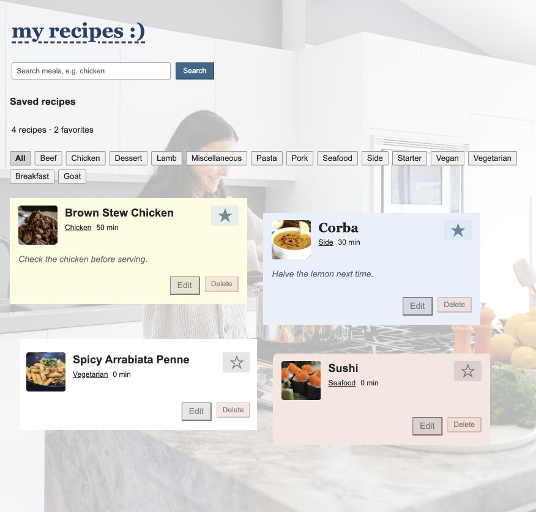
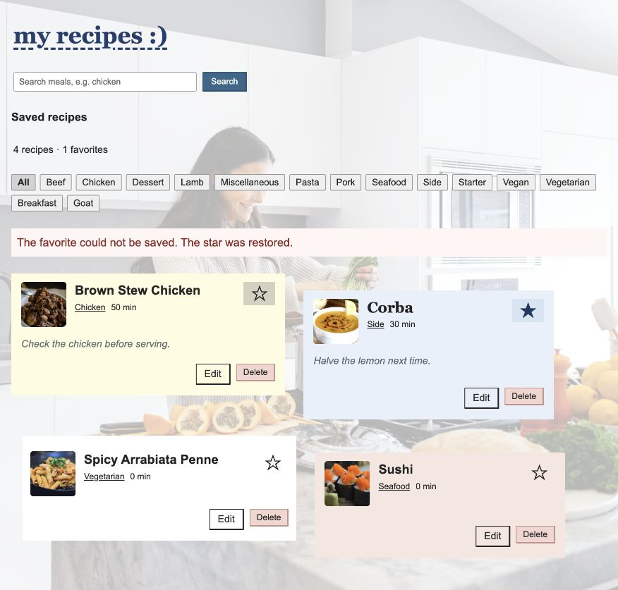

# My Recipe Manager

A recipe app for MA 2. Search for a meal, save it, and add your own time and
notes. Use the category buttons to filter the list, or click a star to mark
a favorite. You can also delete saved meals.

This version uses a local API instead of localStorage. Saved recipes are in
`db.json`. The `ma1-final` tag keeps the earlier MA 1 version.

## Run it

Use Node 22.12+ (tested with Node 24). Internet is needed for TheMealDB.

```sh
npm install
cp .env.example .env
```

Keep two terminals open in the project folder.

Terminal 1:

```sh
npm run api
```

Terminal 2:

```sh
npm run dev
```

Open the URL printed by Vite. The recipe API runs on port 3001. It uses
`json-server` version `0.17.4` with an 800 ms delay so the saving and favorite
states are visible. Keep both servers running.

```sh
npm run build
npm test
```

The build checks for TypeScript errors. The tests check searches, saving,
editing, and the star rollback.

## Saved meals

The instructions require at least four saved recipes. Brown Stew Chicken and
Corba came with the starter. Spicy Arrabiata Penne and Sushi were saved from
TheMealDB to make four. These exact dishes are not required. The category
buttons also come from TheMealDB, as required by the assessment.

## How the data works

Meals come from TheMealDB. The API file changes its field names to the names
used in the app and removes blank ingredients. No matches means an empty list.
Saved meals use GET to load, POST to save, PATCH to edit, and DELETE to remove.
The components use hooks to do this.

## Query keys

The search key is `["meals", term]` so chicken and corba keep separate results.
Going back to chicken shows chicken again. A blank search sends no request.
`["categories"]` is for the category list and `["recipes"]` is for saved meals.
Those requests do not need a search word in the key. After a save, edit, or
delete, the app marks the saved list as stale and gets the latest list from
the server. Filtering uses that list directly.

## Favorite rollback check

The star changes before the server responds. The hook cancels a pending refetch,
keeps the previous list, and changes the matching recipe without mutating it.
If PATCH fails, the old list is restored. It invalidates the list after either
success or failure.

For this check, the PATCH URL temporarily ended in `${id}-nope`. The server
returned 404 after about 800 ms. The first screenshot shows Brown Stew Chicken
with a filled star while the request is pending:



After the failure, it returned to an empty star and the favorite count went
from two back to one:



The temporary URL was removed afterwards. A normal favorite update was checked
against the server and saved successfully.

## Before submitting

- The repository must be public.
- Confirm `jeffdteach` is a collaborator in the repository settings.
- Keep `.env` untracked and commit `.env.example` and `db.json`.
- Run both server commands on your computer and try a search, save, edit, star,
  and delete.
- Check the commits with `git log ma1-final..HEAD --oneline`.

The development session verified a fresh install, build, tests, and live API
operations. Its sandbox could not start the directory watcher (`EMFILE`), so
its temporary preview used the same API without watch mode. The required
`npm run api` command above still includes `--watch` and should be checked in
your normal terminal before submission.
