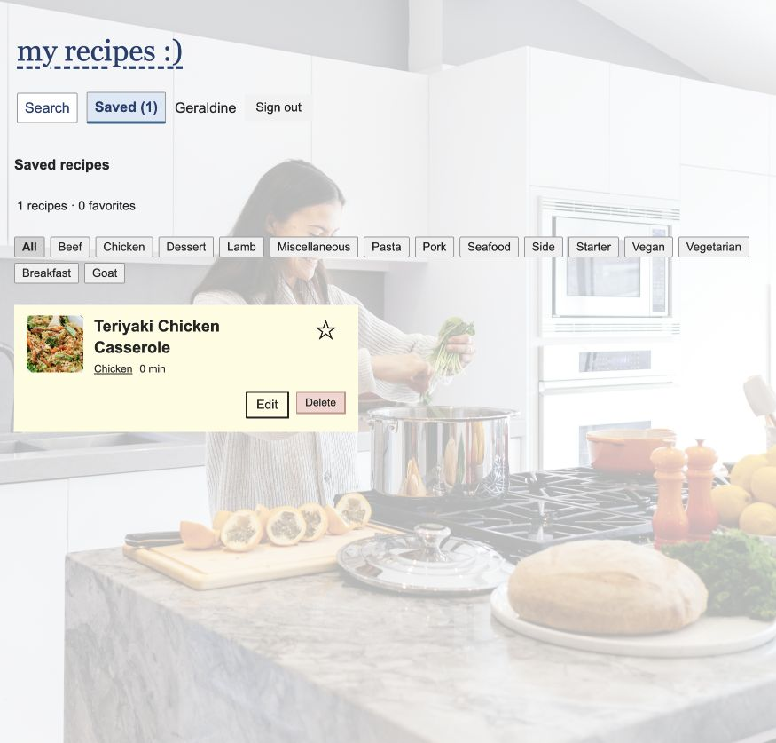

https://recipe-manager-pi-eight.vercel.app



# My recipes

A recipe app for MA3. Search for meals, open their ingredients, and save the ones you want. Saved recipes have stars, category filters, prep time and notes.

## Run it

Use Node 20 or newer.

```sh
npm install
cp .env.example .env
npm run dev
```

One terminal is enough. MA3 uses browser storage, so there is no json-server to start.

```sh
npm test
npm run build
npm run preview
```

## Pages

- `/` — search and save meals.
- `/login` — enter a display name.
- `/saved` — view and edit saved recipes after signing in.
- `/recipe/:mealId` — view one meal and its ingredients.
- Any other path — a 404 page with a link back to Search.

The header is shared across the pages. Recipe titles use React Router links. Opening Saved while signed out takes you to Login, then back to Saved. The redirects use `replace` so Back doesn't keep sending you through the login guard.

This is a practice login, not a secure account. There is no password. Names and recipes stay in the browser. Changing the name doesn't create a separate collection, and clearing browser data removes the saved recipes.

## What changed from MA2

The four functions in recipes.api.ts now use localStorage. They still return promises, so recipes.hooks.ts stayed unchanged. New recipes get a string id from `crypto.randomUUID()`. Card props use `SavedRecipe["id"]` so their types follow the model.

Bad stored rows are skipped. If a write fails, the app shows an error. The star changes immediately and goes back to its previous value if saving fails.

Query keys are `["recipes"]`, `["meals", term]`, `["categories"]` and `["meal", mealId]`. Different search terms and recipe ids have separate cache entries. Saving, editing and deleting refresh the saved-recipe query.

## Deployment

The Vercel project imports `geraldinetorno1-png/recipe-manager` with the Vite preset. Production and Preview use:

```text
VITE_MEALDB_URL=https://www.themealdb.com/api/json/v1/1
```

Vite puts this URL into the built JavaScript. Changing it needs a redeploy. It isn't secret, so passwords and private keys don't belong in VITE_ variables.

`vercel.json` sends page requests to index.html. React Router then picks the page. Without that rewrite, a recipe link can work when clicked but fail when opened directly or refreshed.

## Checks

The tests cover storage, broken saved data, failed writes, login, redirects, missing meals, search retries and editing. The live app was also checked for saving and refresh, recipe deep links, login redirects, 404 pages and `/recipe/99999999`. It opened in an incognito window, and the browser check showed no console errors or warnings.

Still to do: the handout's deliberate deployment failure exercises and confirmation of the teacher's collaborator access. With the current startup guard, a missing environment variable shows a VITE_MEALDB_URL error before any meal request is sent.

The `ma2-final` tag keeps the MA2 version, its saved recipes and rollback screenshot. MA3 commits come after that tag.
